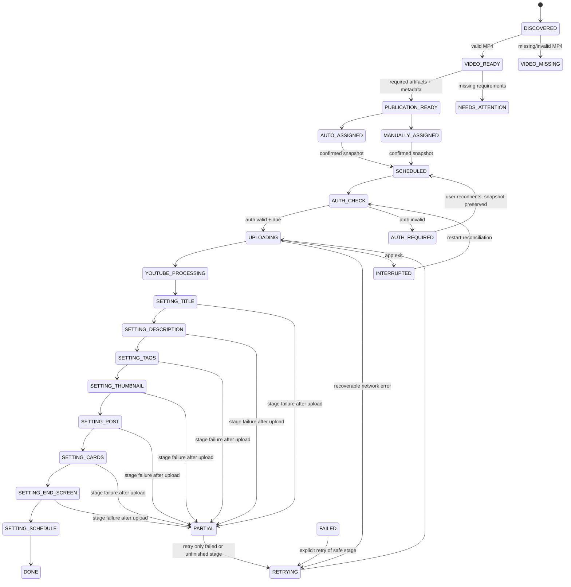

# YouTube Publication V2 Implementation Plan

> **For agentic workers:** REQUIRED SUB-SKILL: Use `subagent-driven-development` (recommended) or `executing-plans` to implement this plan task-by-task. Steps use checkbox (`- [ ]`) syntax for tracking.

**Goal:** сделать публикацию YouTube прозрачным массовым workflow: от готового MP4 до проверяемого назначения, независимого расписания каждого канала, загрузки, оформления и подтверждённого результата без противоречивых счётчиков и повторных загрузок.

**Architecture:** текущие списки результатов монтажа, папок пакетов и заданий очереди объединяются в один проекционный реестр `PublicationItem`, привязанный к стабильному `ProductionItem ID`. Реестр вычисляет readiness и counters из артефактов, а подтверждённые назначения превращает в неизменяемые snapshots для очереди upload. Отдельный mutable `PublicationExecution` ведёт поэтапный результат, таймлайм, время, попытки и YouTube ID, никогда не изменяя исходный snapshot.

**Tech Stack:** Python 3 (`scriptor/bridge.py`, `config.py`, `youtube_publisher.py`, `youtube_allocation.py`, YouTube OAuth/Data API), Electron/React/TypeScript (`studio-ui-remotion-verify/src/ui/App.tsx`), локальный JSON settings с DPAPI для OAuth secrets, `unittest`, `pnpm typecheck`.

**Spec:** `C:\Users\borov\.codex\attachments\81a394e0-b80b-4ff9-a920-f9b5dc14db6f\pasted-text.txt`

## Global Constraints

- Эта фаза — только audit/design/plan: не загружать ролики, не менять OAuth, расписание или данные проекта.
- В реализации V2 все новые связи строить по stable `ProductionItem ID`, не по filename и не по позиции строки UI.
- Не удалять отсутствующие артефакты автоматически: показывать понятный missing state и путь восстановления.
- OAuth refresh token остаётся DPAPI-защищённым и никогда не попадает в UI snapshot, логи или Markdown.
- Повторный auto-distribution не меняет manual, locked, scheduled, uploading, uploaded или done assignment без явного reset пользователя.
- `READY`/`DONE` upload не должен запускаться повторно обычным Resume.
- Upload, обработка YouTube, metadata, thumbnail, post, cards, end screen и schedule — независимые idempotent stages; completed/irreversible stage не повторяется без явного reset.
- `youtubeVideoId` сохраняется сразу после создания видео на YouTube; обычный retry/restart с существующим ID никогда не создаёт второй video.
- Расписание принадлежит каналу: quota отвечает на «сколько», scheduler отвечает на «когда»; каналы не делят общий интервал.
- Время в snapshots хранится как ISO-8601 со смещением/timezone; UI всегда показывает timezone явно.

---

## 1. Executive Summary

Publication V2 должен заменить нынешний набор независимых «шагов» одной центральной рабочей моделью: **один ProductionItem → один набор артефактов → одно назначение → один frozen publication snapshot → одно или несколько явных состояний выполнения**.

В текущей версии полезные части уже есть: локальные result packages, очередь, OAuth на отдельный Chrome-профиль канала, детерминированное распределение по квотам, scheduler, параллельная upload-очередь и idempotent Studio-оформление. Но они соединены не единым объектом, а через package-folder и отдельные списки. Отсюда и противоречивые числа и непрозрачность.

V2 не должен начинаться с нового дизайна поверх старых списков. Сначала вводится реестр публикационной готовности и миграция старых records; затем — таблица, assignment preview и только после этого новая очередь.

## 2. Current Implementation Audit

| Слой | Реальное состояние | Вывод для V2 |
|---|---|---|
| Монтаж | `pipeline_montage_outputs` хранит готовые MP4 paths; `video_result_packages` связывает существующий MP4 с папкой результатов. | Сохранить как источник видео-артефактов, но дополнить `productionItemId` и validation record. |
| Publication queue | `youtube_publication_jobs` содержит `PublicationJob`: UUID job id, video/package paths, title, SEO, tags, thumbnail path, channel, schedule и upload fields. | Сохранить как legacy queue и мигрировать в snapshot-backed jobs. Сейчас это не production identity. |
| Ready button | `snapshot()` выдаёт `readyOutputs` только для существующих video+folder, package folder которых ещё нет в queue. | Это именно «непоставленные в очередь пакеты», а не «все готовые ролики». Переименовать и заменить readiness table. |
| Allocation | `youtube_allocation.py` чисто вычисляет 3/2/1 quota, duration range и longest-first для monetized channels. | Хорошая база, но стратегии и lock semantics надо расширить. |
| Channel data | `analytics_channels` использует `profile_id` как local stable id; monetization сейчас выводится из `monetary_access`. | Reuse `profile_id` как `channelId`, отделить коммерческий флаг от доступности monetary OAuth. |
| OAuth | protected `youtube_oauth_tokens` map привязан к channel profile; есть cloud handoff/loopback, refresh и analytics validation. | Оставить transport/secret storage, добавить явный validation state в read model. |
| Upload | `upload_publication_jobs` проверяет title/status/OAuth и запускает workers. | Добавить preflight и immutable snapshot до запуска, чтобы file/metadata/rules не менялись во время job. |
| Studio automation | `youtube_engagement_tasks` уже persistent/idempotent для post/cards/end screen. | Сохранить как downstream sub-tasks publication job, не как отдельный непонятный Step 5. |
| UI | Publication dashboard, allocation cards, time-grid и upload/Studio sections сосуществуют как step UI. | Заменить на tabs, одну таблицу роликов, drawer правил канала и отдельный queue/history. |

## 3. Existing Working Components

- `scriptor/youtube_publisher.py`: создание private draft, package metadata, duration measurement, title validation, schedule primitives.
- `scriptor/youtube_allocation.py`: pure deterministic allocation; тестируется без Google и файлов.
- `scriptor/youtube_oauth.py` и bridge OAuth commands: отдельная авторизация каждого Chrome profile, protected tokens, token refresh.
- `scriptor/bridge.py`: persistence `youtube_publication_jobs`, presets, activity, allocation profiles, upload worker concurrency, Studio task adoption/reconciliation.
- `scriptor/youtube_engagement.py`: resumable post/cards/end-screen states.
- Existing test coverage in `tests/test_youtube_publisher.py`, `tests/test_youtube_allocation.py`, `tests/test_youtube_engagement.py`.

## 4. Current Problems / Root Causes

### Why “84 ready” and “Add ready (0)” can both be true

They are different counters.

1. Montage/result counters count completed MP4 paths (`pipeline_montage_outputs`) or all existing result packages (`video_result_packages`).
2. `publication.readyOutputs` counts only result packages that still exist **and whose `packageFolder` is absent from `youtube_publication_jobs`**.
3. Therefore 84 final packages may exist (or be shown as montage-ready), while the button shows 0 because all 84 folders already have a legacy queue row — even if those queue rows are unassigned, blocked, missing a thumbnail, or failed.

The folder-string deduplication also hides a package from the button after a partial/failed queue record exists. It is not a publication readiness check.

### Why “88 missing” can appear

`build_allocation_summary()` calculates `missing = max(sum(channel quotas) - assigned queue jobs, 0)`. It is the number of quota slots still unassigned, not the count of missing MP4, and it intentionally ignores montage/result-package counters. A plan with quotas totalling 88 and zero assignments shows “создать ещё 88” even if 84 videos already exist.

### Other root causes

- No single `ProductionItem ID` is stored in current `PublicationJob`; link is package folder/video path/script name.
- `VIDEO_READY`, metadata completion, assignment and upload state collapse into `status` values intended for queue execution.
- Monetized-first is hard-coded in allocation ordering; it is not a user-selectable strategy.
- Manual channel move writes `channelId` but has no explicit `assignmentSource`, `lockedAt` or lock policy; rerun safety cannot be proven from data alone.
- Channel rules are split across allocation cards, publication presets and engagement policy details.
- Current upload preflight does not make the UI show per-item missing artifacts before user starts upload.
- OAuth UI exposes a boolean `oauthConnected`, not `CONNECTED/DISCONNECTED/EXPIRED/AUTH_REQUIRED/ERROR` with last validation.

## 5. Source of Truth

Introduce a persisted `publication_items` map keyed by `productionItemId`. It is the only source for V2 counters and central table rows. Files remain authoritative for existence; the map stores observed validation, not a substitute for files.

```ts
type PublicationItem = {
  productionItemId: string;
  legacyLinks: { packageFolder?: string; videoPath?: string; legacyJobId?: string };
  artifacts: {
    video?: ArtifactRef; thumbnail?: ArtifactRef; seo?: SeoArtifactRef;
    audio?: ArtifactRef; script?: ArtifactRef;
  };
  metadata: { title: string; description: string; tags: string[]; durationSeconds?: number };
  readiness: PublicationReadiness;
  assignment?: PublicationAssignment;
  jobIds: string[];
  updatedAt: string;
};
```

`ArtifactRef` includes immutable logical ID, path, observed existence, size/mtime, validation error and `validatedAt`. `PublicationItem` does not store credentials.

### Readiness definitions

- `VIDEO_READY`: final MP4 exists, is readable, has positive measured duration.
- `PUBLICATION_READY`: `VIDEO_READY` plus title (1–100), description, tags/SEO policy satisfaction, existing thumbnail when channel policy requires it, valid assignment and publish time when scheduling is required.
- `NEEDS_*`: one or more named blocking reasons. It is never inferred only from a filename.

## 6. Proposed UX Architecture

Use five tabs, with a single shared filter state and a stable row URL/selection by `productionItemId`:

1. **Ролики** — central readiness table and batch validation.
2. **Каналы** — connected status, quota/rules and channel drawer.
3. **Распределение** — dry-run preview, conflicts and manual corrections.
4. **Очередь** — confirmed snapshots and live per-video execution; no hidden candidate generation.
5. **История** — immutable publication receipts, completed stage results and recoverable errors after restart.

Level 1 is an overview bar; level 2 is the Videos/Distribution workspace; level 3 is the channel-rule drawer or an expanded Queue row. Do not show every timestamp in the main table: execution detail belongs in the row expansion.

### Queue observability rules

- Main Queue table shows only: number, title, duration, channel, publish time, Upload, completion `X/Y`, overall status and current stage.
- Every row expands into a complete checklist and append-only live timeline. A saved event includes stage, result, timestamps, duration, attempt and a safe human-readable reason.
- Upload transport progress is shown only when the transport provides it (`percent`, transferred bytes, speed, elapsed, ETA). Unknown transport fields remain unavailable, never estimated or fabricated.
- `YouTube processing` is visually and semantically different from `MP4 upload`.
- A partially successful row stays actionable: e.g. `Cards FAILED` exposes «Повторить карточки», not «Загрузить MP4 снова».

## 7. ASCII Wireframes

```text
+----------------------------------------------------------------------------------+
| Публикация YouTube                                                               |
| Всего 84 | VIDEO_READY 84 | Готово к публикации 76 | Внимание 8 | Очередь 72    |
+----------------------------------------------------------------------------------+
| [Ролики] [Каналы] [Распределение] [Очередь] [История]                            |
+----------------------------------------------------------------------------------+
| Поиск [________________]  [Все v] [Требуют внимания v]  [Проверить готовность]  |
| [Распределить автоматически] [Предпросмотр] [Подтвердить 72 назначения]         |
+----------------------------------------------------------------------------------+
| № | Название              | Длит. | Видео | Обл. | SEO | Канал | Время | Статус |
| 1 | ...                   | 12:43 |   ✓   |  ✓   |  ✓  | A     | 12:00 | READY  |
| 2 | ...                   | 08:21 |   ✓   |  ✕   |  ✓  | —     | —     | COVER  |
+----------------------------------------------------------------------------------+
```

```text
+---------------------------- Канал: Взгляд Сверху -------------------------------+
| Auth: CONNECTED · account@example… · validated 10.09 12:14 [Проверить] [Войти] |
| [✓] Канал активен    [✓] Монетизирован                                           |
| Quota per batch [ 5 ]  Strategy [Самые длинные → монетизированные v]             |
| Min duration [     ]  Max duration [     ]                                        |
| First publish [10.09.2026 12:00] Interval between videos on this channel [180]m  |
| [✓] Upload  [✓] Description  [✓] Thumbnail  [✓] Cards  [✓] End screen            |
|                                                [Сохранить правила]               |
+----------------------------------------------------------------------------------+
```

```text
+------------------------- Предпросмотр распределения ----------------------------+
| Changes are not uploaded and do not mutate locked/scheduled jobs.               |
| #01  15:55 → Взгляд Сверху (AUTO, longest/monetized) → 10.09 12:00               |
| #02  14:48 → Острый Вопрос  (MANUAL LOCKED)          → 10.09 13:00               |
| #03  08:21 → —  missing thumbnail                                                   |
| [Назад] [Применить 19 auto assignments] [Подтвердить и создать snapshots]        |
+----------------------------------------------------------------------------------+
```

```text
+---------------------------------- ОЧЕРЕДЬ ---------------------------------------+
| Всего 84 | Ожидают 34 | Upload 6/6 | Processing 3 | Оформление 4 | Ready 31      |
| Полностью готовы 5 | Внимание 1                                                |
| [Запустить выбранные] [Продолжить безопасные] [Повторить ошибочный этап]         |
+----------------------------------------------------------------------------------+
| № | Название      | Канал          | Выход (Europe/Warsaw) | Upload | Оформл. | Статус |
|14 | После Москвы… | Взгляд Сверху  | 10.09 18:00           | 64%    | 0/7     | UPLOADING |
|15 | …             | Острый Вопрос | 10.09 16:00           | ✓      | 6/7     | PARTIAL   |
+----------------------------------------------------------------------------------+
| ▸ #14  Текущая стадия: Загрузка MP4 — 64% · 620 / 970 MB · 18.4 MB/s · ETA 00:19|
| ▸ #15  Текущая стадия: Карточки — ошибка · [Повторить карточки]                 |
+----------------------------------------------------------------------------------+
```

```text
+--------------------------- #15 · Ход публикации ---------------------------------+
| Video upload       ✓ 22:40:58  44 сек       YouTube video ID: abc123             |
| YouTube processing ✓ 22:42:03  1м 05с       [Открыть на YouTube]                 |
| Title              ✓ 22:42:05  1.1 сек      SEO package: READY                    |
| Description        ✓ 22:42:06  0.4 сек      Requested: 10.09 18:00 Europe/Warsaw|
| Tags               ✓ 22:42:06  0.3 сек      Confirmed: 10.09 18:00 Europe/Warsaw|
| Thumbnail          ✓ 22:42:12  5.8 сек                                             |
| Post               ✓ 22:42:30  7.2 сек                                             |
| Cards              ✕ 22:42:41  attempt 2/4 · Studio не подтвердил сохранение      |
| End screen         WAITING                                                        |
| Schedule           ✓ 22:42:50                                                      |
| Итог: PARTIALLY COMPLETED · MP4 повторно не будет загружен                         |
| [Повторить карточки] [Повторить с этапа]                                           |
+----------------------------------------------------------------------------------+
```

```text
+--------------------------------- ИСТОРИЯ ----------------------------------------+
| Фильтр [канал v] [результат v] [дата v]                                           |
| #15 · После Москвы… · Взгляд Сверху · youtube.com/watch?v=abc123                 |
| Upload 09.09 22:40 → 22:40 · Schedule 10.09 18:00 Europe/Warsaw · SCHEDULED      |
| MP4 ✓ Title ✓ Description ✓ Tags ✓ Thumbnail ✓ Post ✓ Cards ✕ End screen WAITING|
| [Открыть receipt] [Открыть YouTube]                                               |
+----------------------------------------------------------------------------------+
```

## 8. User Flow

1. Montage writes/updates a final video artifact for its ProductionItem.
2. Publication reconciles artifacts and shows every production item, including missing files.
3. User opens **Ролики**, sees readiness and filters `Требуют внимания`.
4. User configures individual Channel Rules in **Каналы** and validates OAuth.
5. User clicks **Распределить автоматически**; this is a pure dry-run.
6. User reviews complete mapping, reasons, quotas and per-channel times in **Распределение**.
7. User manually changes a channel/time where needed; these rows become `MANUALLY_ASSIGNED` or `LOCKED`.
8. User clicks **Подтвердить распределение**. Only then do immutable publication snapshots/jobs get created.
9. Queue preflight validates files, metadata, auth and schedule; blockers link to exact rows.
10. User starts selected valid jobs. Upload, processing, metadata, thumbnail and Studio tasks report independently.
11. On restart, snapshots/jobs reconcile with YouTube and continue only safe unfinished work.

## 9. ProductionItem Readiness Model

```text
DISCOVERED
  -> VIDEO_MISSING | VIDEO_INVALID | VIDEO_READY
VIDEO_READY
  -> METADATA_INCOMPLETE | ASSET_INCOMPLETE | ASSIGNMENT_REQUIRED | PUBLICATION_READY
PUBLICATION_READY
  -> AUTO_ASSIGNED | MANUALLY_ASSIGNED | LOCKED
ASSIGNED + publish time -> SCHEDULED_CANDIDATE
```

Readiness is a set of flags/reasons, not a mutable execution status. A row can be `VIDEO_READY` and `NEEDS_COVER` at the same time.

## 10. Channel Model

Reuse `analytics_channels[].profile_id` as `channelId`; keep its display order separately from identity. Add a `ChannelPublicationRules` record keyed by `channelId`:

```python
ChannelPublicationRules = {
  "channelId": str, "enabled": bool, "monetized": bool,
  "quota": int, "distributionStrategy": "longest_monetized" | "ordered" | "balanced" | "manual",
  "preferLongestForMonetized": bool,
  "minDurationSeconds": float | None, "maxDurationSeconds": float | None,
  "firstPublishAt": str | None, "intervalMinutes": int,
  "timezone": str, "publishWindowStart": "HH:MM" | None, "publishWindowEnd": "HH:MM" | None,
  "allowedWeekdays": list[int] | None, "maxVideosPerDay": int | None,
  "requireThumbnail": bool, "privacy": "private" | "unlisted" | "public",
  "automation": {"upload": bool, "metadata": bool, "thumbnail": bool, "cards": bool, "endScreen": bool},
}
```

`monetized` is an explicit user business rule. `monetary_access` remains OAuth scope/capability and must not silently turn monetization off.

## 11. Channel Rules

- enabled/disabled;
- explicit quota per batch, zero means no auto assignment;
- monetized flag and optional prefer-longest rule;
- duration range, only as an eligibility constraint;
- first publish time and **interval between videos on this same channel**;
- channel timezone, optional allowed weekdays, an optional publication window and optional daily cap;
- privacy and automation toggles;
- auth status read-only with explicit validate/reconnect actions.

The rule editor is a drawer/full tab, not an inline mini-card. Saving rules recalculates only a preview; it never changes confirmed jobs.

## 12. Automatic Matching Algorithm

Input: `PublicationItem[]`, `ChannelPublicationRules[]`, existing assignments. Output: `DistributionPreview` only.

1. Validate each item; candidates are `PUBLICATION_READY` and not already `SCHEDULED/UPLOADING/DONE`.
2. Preserve `MANUALLY_ASSIGNED` and `LOCKED`, consume their channel quota, and keep their time.
3. Remove disabled, invalid-auth and quota-zero channels from auto candidates; explain exclusion.
4. Apply chosen strategy with stable tie-breaker: `durationSeconds DESC`, then `productionItemId ASC` for longest; original frozen production batch order for ordered; lowest assigned/quota ratio then channel UI order for balanced.
5. For `longest_monetized`, fill eligible monetized quotas with longest compatible remaining items first, then all other eligible channels according to strategy order.
6. Enforce duration compatibility and quota. Leave overflow `UNASSIGNED` with exact reason, never silently drop it.
7. Calculate per-channel times from that channel's own first time/interval; no cross-channel interval is implied.
8. Rerun recomputes only `UNASSIGNED` and nonlocked `AUTO_ASSIGNED`; it returns a diff (`unchanged`, `new`, `would move`, `blocked`) before apply.

### Example: 20 eligible videos

Channel A monetized quota 3, Channel B monetized quota 2, C quota 5, D quota 5, strategy `longest_monetized`:

- ranks 1–3 by duration → A;
- ranks 4–5 → B;
- remaining original batch order alternates C/D until quotas; remaining 5 stay `UNASSIGNED` if no channel quota exists.
- a manual locked #02 on D is preserved first and reduces only D capacity.

## 13. Longest Video → Monetized Channels Logic

Make this a named `distributionStrategy`, not an implicit side effect of `monetized`. The preview must display `reason = "longest_monetized"`, duration and channel quota for every auto assignment. If disabled, monetization does not affect ordering.

## 14. Per-Channel Quota Logic

`quota` is always user-visible and explicit. It answers only **how many** videos the channel receives in the batch. Legacy 3/2/1 suggestions can appear as a nonbinding helper, but V2 counters use only saved rules. The per-channel scheduler answers **when** those quota items publish. Counters are:

- total discovered;
- video ready;
- publication ready;
- assigned;
- unassigned ready;
- scheduled;
- uploading;
- uploaded/published;
- failed;
- quota slots remaining (separate, never called missing videos).

## 15. Manual Override / Locking

`PublicationAssignment`:

```python
{
  "productionItemId": str, "channelId": str, "publishAt": str | None,
  "source": "auto" | "manual", "locked": bool, "reason": str,
  "createdAt": str, "updatedAt": str,
}
```

Manual change sets `source=manual`; explicit lock sets `locked=true`. Reset Assignment is the only command permitted to return it to auto allocation. Confirmation freezes a copy into the publication snapshot.

## 16. Scheduling Model

Scheduler is per channel and never derives one channel's slots from another channel. Sort only that channel's assigned items by planned order. In the simple case, `slot[n] = firstPublishAt + n * intervalMinutes`.

`intervalMinutes` is the normalized persisted value; UI supports either `[3] [часа]` or `[180] минут`. A manual time is retained with `source=manual, locked=true`; later auto-distribution and rescheduling do not overwrite it.

The slot resolver performs these checks in order:

1. Start from the channel's `firstPublishAt` in its IANA `timezone`.
2. Add `intervalMinutes` for the next automatic item.
3. If the local date is not in `allowedWeekdays`, advance to the next allowed date at the earliest legal time.
4. If the time falls outside `[publishWindowStart, publishWindowEnd]`, advance to the next allowed window; never schedule it at night merely to keep the interval.
5. If `maxVideosPerDay` has been met, advance to the next allowed day/window.
6. Persist requested `publishAt` as an ISO-8601 datetime with offset and display the named timezone. Never store ambiguous local wall-clock strings.

Before confirmation the Distribution preview lists every computed slot, grouped by channel. A confirmed YouTube schedule stores both `requestedPublishAt` and `confirmedPublishAt`; differing values are a visible discrepancy, not a silent replacement.

```text
Взгляд Сверху · quota 3 · first 10.09 12:00 · interval 3 часа · Europe/Warsaw
#01 → 10.09 12:00   #02 → 10.09 15:00   #03 → 10.09 18:00

Острый Вопрос · quota 4 · first 10.09 10:00 · interval 2 часа · Europe/Warsaw
#04 → 10.09 10:00   #05 → 10.09 12:00   #06 → 10.09 14:00   #07 → 10.09 16:00
```

## 17. OAuth/Auth UX

Expose an independently validated read model:

```text
CONNECTED | DISCONNECTED | EXPIRED | AUTH_REQUIRED | ERROR | VALIDATING
```

Each row shows channel name, stable channel ID, safe masked account identity, last validation, status/reason and action. `CONNECTED` means validation passed, not merely that a protected token string exists. Invalid auth removes the channel from automatic allocation and preflight; it does not delete the saved assignment.

## 18. Publication Queue

Confirmation creates one immutable `PublicationSnapshot` and one mutable `PublicationExecution` per valid assigned ProductionItem. Snapshot contains production item ID, resolved artifact fingerprints/paths, all metadata, channel ID, OAuth account identity fingerprint, privacy, requested publish time and automation flags. UI changes and rule edits do not mutate snapshots.

`PublicationExecution` owns only what happened: current stage, overall result, YouTube identity, each stage result and chronological events. It can become `PARTIAL` / `NEEDS_ATTENTION` while retaining completed successful stages.

The UI must not collapse these stages into `APPLYING_METADATA`:

```text
AUTH_CHECK → VIDEO_UPLOAD → YOUTUBE_PROCESSING → TITLE → DESCRIPTION → TAGS
→ THUMBNAIL → POST → CARDS → END_SCREEN → SCHEDULE → DONE
```

Each stage is one of `PENDING`, `WAITING`, `RUNNING`, `SUCCESS`, `FAILED`, `RETRYING`, `SKIPPED`, `NOT_REQUIRED`. The row-level status is derived from those stages: `READY`, `SCHEDULED`, `UPLOADING`, `PROCESSING`, `FORMATTING`, `PARTIAL`, `AUTH_REQUIRED`, `FAILED`, `INTERRUPTED` or `DONE`.

Batch counters derive from executions: waiting, uploading, YouTube processing, formatting, scheduled, fully ready, attention/errors, and `concurrentUploads / configuredUploadConcurrency`.

## 19. Publication State Machine



## 20. Execution Observability, Persistence / Restart / Resume

- Persist `publication_items`, rules, assignments, snapshots and jobs atomically with existing settings format.
- Persist an append-only bounded `timeline` for every execution and a durable final receipt for History. An event contains `stage`, `status`, `startedAt`, `finishedAt`, `durationMs`, attempt, progress when supplied, and a safe detail/error reference.
- Store execution-wide `uploadStartedAt`, `uploadCompletedAt`, `processingStartedAt`, `processingCompletedAt`, `plannedPublishAt`, `confirmedPublishAt`, and `actualPublishedAt` when YouTube provides it. Upload duration and processing duration are not interchangeable.
- On startup, validate artifact paths non-destructively and reconcile `UPLOADING/INTERRUPTED` by YouTube video ID before attempting an upload.
- A job with uploaded `videoId` never repeats file upload; missing later metadata/thumbnail resumes at that sub-step.
- Store idempotency key based on snapshot ID + channel ID, not filename.
- Preserve legacy activity/engagement task history and map it to migrated job IDs.
- Store timing aggregates (upload, processing, metadata, Studio, total) as telemetry data for later reporting; V2 does not require a separate analytics dashboard.

## 21. Error / Retry Model

| Error | State | Safe action |
|---|---|---|
| Missing/corrupt MP4 | `NEEDS_VIDEO` | Block only item; revalidate after montage repair. |
| Missing thumbnail | `NEEDS_COVER` | Block only if channel rule requires cover; never delete reference. |
| OAuth expired | `AUTH_REQUIRED` | User reconnects channel; snapshot remains. |
| Network/5xx | `RETRYING` | bounded exponential retry then failed, no duplicate video insert. |
| YouTube quota | `FAILED_QUOTA` | stop affected jobs, explain reset/user action; no blind loop. |
| Upload interrupted | `INTERRUPTED` | reconcile by idempotency/video ID on restart. |
| Title/description/tags/thumbnail/post/cards/end screen failure | `PARTIAL` failed sub-step | retry only failed or unfinished downstream step; do not reupload MP4. |

Failed step detail stores `step`, error category, human-readable reason, provider/API code when available, attempt number, `failedAt`, `nextRetryAt` and `lastSuccessfulStep`. Raw traceback stays in local diagnostic logging, not the normal UI.

OAuth expiry is a recoverable `AUTH_REQUIRED` state: show the channel and that MP4 already exists, offer reconnect, then continue with the first unfinished stage.

## 22. Data Model Changes

Add to `Settings`:

```python
youtube_publication_items: dict[str, dict]
youtube_channel_publication_rules: dict[str, dict]
youtube_publication_assignments: dict[str, dict]
youtube_publication_snapshots: dict[str, dict]
youtube_publication_migration_version: int
```

Add execution records separate from those immutable inputs:

```python
PublicationExecution = {
  "jobId": str, "snapshotId": str, "productionItemId": str,
  "currentStage": str, "overallStatus": str,
  "youtubeVideoId": str | None, "youtubeVideoUrl": str | None,
  "startedAt": str | None, "completedAt": str | None,
  "plannedPublishAt": str | None, "confirmedPublishAt": str | None,
  "actualPublishedAt": str | None,
  "uploadStartedAt": str | None, "uploadCompletedAt": str | None,
  "processingStartedAt": str | None, "processingCompletedAt": str | None,
  "steps": dict[str, PublicationStepResult], "timeline": list[PublicationTimelineEvent],
}

PublicationStepResult = {
  "status": str, "startedAt": str | None, "finishedAt": str | None,
  "durationMs": int | None, "attempts": int, "error": dict | None,
  "providerResult": dict | None, "progress": dict | None,
}
```

`PublicationSnapshot` is the frozen intended input; execution fields are never written back into it.

Keep old `youtube_publication_jobs`, allocation profiles/presets and engagement tasks during migration. The V2 adapter reads old fields but no new code should use package folder as identity. Add types to `desktop.d.ts`/`NewsFlowSnapshot` before UI work.

## 23. Migration From Current Publication UI

1. Discover a `productionItemId` from existing production metadata. If unavailable, create one deterministic migration identity from canonical video path + package folder and record migration provenance.
2. Build `PublicationItem` for every legacy result package, including missing files.
3. Attach legacy queue job to item by exact canonical package/video path; ambiguous matches are surfaced, not guessed.
4. Convert `channelId`, `publishAt` into assignments; user moves become `manual` only when activity/history proves manual action, otherwise `auto` and unlocked.
5. Convert allocation profile quotas/ranges to `ChannelPublicationRules`; preserve legacy settings without interpreting `monetary_access` as monetization.
6. Freeze legacy uploaded fields (`videoId`, `videoUrl`, `uploadedAt`) in a migrated snapshot so they cannot upload again.
7. Produce migration audit counts: migrated, ambiguous, orphan queue jobs, missing artifacts, preserved uploaded jobs.

## 24. Implementation Phases

### Task 1: Establish PublicationItem domain and read-only reconciliation

**Files:**
- Create: `scriptor/publication_model.py`
- Modify: `scriptor/config.py`, `scriptor/bridge.py`
- Test: `tests/test_publication_model.py`

**Interfaces:**
- Produces `reconcile_publication_items(settings: Settings) -> PublicationReconciliation`.
- Produces `PublicationItemReadiness` with `video_ready`, `publication_ready`, `reasons`.

- [ ] Write failing tests for exact `ProductionItem ID` linkage, missing MP4, missing thumbnail and package-folder collision.
- [ ] Run `python -m unittest tests.test_publication_model` and confirm current code lacks the domain/reconciliation API.
- [ ] Implement artifact validation with `Path.is_file`, duration probe and non-destructive reason records.
- [ ] Add JSON migration/load/save fields with defaults in `config.py`.
- [ ] Run `python -m unittest tests.test_publication_model tests.test_youtube_publisher`.
- [ ] Commit: `feat(publication): add production-item readiness registry`.

### Task 2: Make all counters derive from the registry

**Files:**
- Modify: `scriptor/bridge.py`, `studio-ui-remotion-verify/src/desktop.d.ts`, `studio-ui-remotion-verify/src/ui/App.tsx`
- Test: `tests/test_publication_model.py`, `tests/test_youtube_publisher.py`

**Interfaces:**
- `publication.counters` returns `total`, `videoReady`, `publicationReady`, `assigned`, `unassigned`, `scheduled`, `uploading`, `done`, `failed`, `quotaSlotsRemaining`.

- [ ] Write failing test with 84 video-ready items, 0 unqueued packages and 88 quota slots; assert labels stay distinct.
- [ ] Implement bridge snapshot projection from `PublicationItem` only.
- [ ] Replace `readyOutputs` button wording with explicit «Новые не добавленные packages» during transition; central KPI uses V2 counters.
- [ ] Run Python tests and `pnpm typecheck`.
- [ ] Commit: `fix(publication): derive counters from one readiness registry`.

### Task 3: Persist rules, deterministic preview and assignment locks

**Files:**
- Modify: `scriptor/youtube_allocation.py`, `scriptor/bridge.py`, `scriptor/config.py`
- Test: `tests/test_youtube_allocation.py`, `tests/test_publication_model.py`

**Interfaces:**
- `build_distribution_preview(items, rules, assignments) -> DistributionPreview`.
- `apply_distribution_preview(preview_id, expected_item_revisions) -> ApplyResult`.

- [ ] Add failing tests for quotas, strategy off/on, manual locks, disabled/auth-invalid channel, duration boundary and stable tie-breaker.
- [ ] Implement pure preview; it must mutate no settings.
- [ ] Implement explicit `assignment.source` and `locked` fields plus reset action.
- [ ] Ensure rerun changes only auto/unlocked assignments and returns a diff.
- [ ] Run focused tests.
- [ ] Commit: `feat(publication): add locked deterministic distribution preview`.

### Task 4: Replace step UI with videos, channels and distribution workspace

**Files:**
- Modify: `studio-ui-remotion-verify/src/ui/App.tsx`, `studio-ui-remotion-verify/src/ui/publication-allocation.css`, `studio-ui-remotion-verify/src/desktop.d.ts`
- Test: frontend typecheck plus existing desktop snapshot tests.

- [ ] Add static typed fixture for all readiness states and write component/unit tests if project harness exists; otherwise add bridge snapshot contract tests first.
- [ ] Implement five tabs, table search/sort/filter/multiselect and problem drill-down by ProductionItem ID.
- [ ] Implement Channel Rules drawer and full preview screen; show auto/manual/locked reason per row.
- [ ] Remove primary navigation to the old Step 1–5 flow; retain legacy details in an expandable migration audit only.
- [ ] Run `pnpm typecheck` and `pnpm build:web`.
- [ ] Commit: `feat(publication): add readiness-first workspace`.

### Task 5: Snapshot-backed schedule and upload preflight

**Files:**
- Create: `scriptor/publication_preflight.py`
- Modify: `scriptor/youtube_publisher.py`, `scriptor/bridge.py`, `scriptor/youtube_engagement.py`
- Test: `tests/test_youtube_publisher.py`, `tests/test_publication_preflight.py`, `tests/test_youtube_engagement.py`

**Interfaces:**
- `create_publication_snapshot(item, assignment, rules, auth_identity) -> PublicationSnapshot`.
- `validate_publication_snapshot(snapshot, channel_auth) -> PreflightResult`.

- [ ] Write failing tests for invalid auth, missing artifact, stale file fingerprint, idempotency and sub-step retry.
- [ ] Create snapshots only after explicit confirmation; persist all resolved metadata/artifacts.
- [ ] Add per-channel scheduler and timezone validation; preserve manual times.
- [ ] Gate upload by successful preflight and convert old jobs to legacy snapshots safely.
- [ ] Run focused tests.
- [ ] Commit: `feat(publication): freeze validated upload snapshots`.

### Task 6: Resume/retry/reconciliation and migration hardening

**Files:**
- Modify: `scriptor/bridge.py`, `scriptor/config.py`, `scriptor/youtube_oauth.py`
- Test: `tests/test_youtube_publisher.py`, `tests/test_youtube_engagement.py`, `tests/test_publication_migration.py`

- [ ] Add failing restart tests for uploaded job, interrupted upload, expired OAuth, metadata-only failure and ambiguous legacy link.
- [ ] Implement startup reconciliation and bounded retry policy without reuploading a known YouTube video ID.
- [ ] Implement migration report/read-only recovery UX and explicit orphan resolution.
- [ ] Run full publication suite and manual dev smoke test with mocked YouTube client only.
- [ ] Commit: `feat(publication): safely resume snapshots after restart`.

### Task 7: Packaged desktop verification

**Files:**
- Modify only packaging/checklist documentation if required.
- Test: portable Windows EXE manual checklist.

- [ ] Run `python -m unittest tests.test_publication_model tests.test_youtube_allocation tests.test_youtube_publisher tests.test_youtube_engagement`.
- [ ] Run `pnpm typecheck` and `pnpm build:web`.
- [ ] Build portable EXE without opening a real upload flow.
- [ ] On a copied test project, verify migration, filter/table, preview, lock, restart and missing-file states; do not alter production project/OAuth.
- [ ] Commit: `test(publication): verify portable V2 workflow`.

## 25. Regression Risks

- Legacy queue records may refer to package folders that were deleted; migration must preserve a missing state instead of removing jobs.
- Existing uploaded videos may lack older `ProductionItem ID`; idempotency mapping must prioritize existing `videoId`.
- Analytics monetization access is not user business preference; migration must not silently change distribution.
- Scheduler timezone conversion can shift appointments; preserve legacy `publishAt` verbatim until user resaves.
- One failed thumbnail/Studio action must not cause MP4 reupload.
- Manual MP3/montage/cover workflows must remain unrelated to publication reconciliation except for their artifact links.

## 26. Acceptance Criteria

- The same central counters never show a package count as an assignment/quota count.
- A user can identify every row by ProductionItem ID and see video, thumbnail, title, description, tags, SEO, channel, time and status.
- 84 video-ready items plus 0 new packages and 88 quota slots are displayed as three distinct facts with labels/reasons.
- Auto distribution is deterministic, respects per-channel quota/range/auth/enabled state and preserves manual/locked/scheduled/uploaded rows.
- Longest-to-monetized is enabled only when its strategy/rule is selected.
- Per-channel interval is clear and produces per-channel schedule times.
- Confirmed jobs contain immutable snapshots; later UI/rule edits do not change them.
- Restart preserves assignments/schedules/jobs; uploaded MP4 is not reuploaded on retry/resume.
- Missing files show a recoverable error state and are never silently deleted.
- OAuth UI distinguishes absent, expired and validated credentials without exposing secrets.
- Existing queue, OAuth and Studio automation regressions pass; Portable EXE test passes without a real YouTube upload.

## 27. Open Questions

1. Is thumbnail mandatory for **every** channel by default, or should the default be optional until each channel enables `requireThumbnail`?
2. Which privacy default should V2 use for newly confirmed snapshots: current `private`, `unlisted`, or a per-channel preset?
3. Should an uploaded scheduled video count toward batch quota immediately (recommended: yes) or only after it becomes public?

## 28. Recommended Final Structure

### TABS

`Ролики` · `Каналы` · `Распределение` · `Очередь` · `История`.

### MAIN TABLE

№, Title, Duration, Video, Thumbnail, SEO, Channel, Publish time, Status, reason, assignment source/lock. It supports search, sorting, filters and multi-select.

### MAIN BUTTONS

`Проверить готовность`, `Распределить автоматически`, `Открыть предпросмотр`, `Подтвердить распределение`, `Запустить выбранные`, `Повторить только failed step`.

### CHANNEL RULES

Dedicated drawer: auth, enabled, monetization, quota, strategy, duration limits, per-channel first time/interval, privacy and automation controls.

### AUTO DISTRIBUTION

Pure deterministic preview first; apply only explicitly selected changes; no upload action occurs in this stage.

### MONETIZED

They receive longest eligible items only when `longest_monetized` is selected. This is auditable per row.

### QUOTAS

User edits direct per-channel numbers. Remaining quota slots are not described as missing videos.

### PREVIEW

Full proposed mapping and exact reason before confirmation; manual values are visibly locked.

### UPLOAD

Starts only from frozen snapshots that pass file/metadata/auth preflight. Metadata/thumbnail/Studio retries are granular and never repeat a completed MP4 upload.

## 29. Keep / Move / Replace / Remove

### KEEP

- Current OAuth transport, channel-specific browser profiles and DPAPI secret handling.
- `youtube_publisher.py` package metadata/duration helpers.
- Pure allocation foundations, upload concurrency controls, activity and engagement task persistence.

### MOVE

- Channel automation rules from current Step 5 into Channel Rules drawer.
- Time-grid presets into per-channel Scheduler settings and saved schedule templates.
- Existing allocation profiles into migrated ChannelPublicationRules.

### REPLACE

- `readyOutputs` as the primary readiness display → registry/table with readiness reasons.
- package-folder-only de-duplication → ProductionItem identity plus artifact fingerprints.
- hard-coded 3/2/1 recommendation as operational quota → optional suggestion.
- implicit manual moves → explicit manual/locked assignment model.
- boolean OAuth connected → validated auth state.

### REMOVE

- Step 1–5 as the dominant workflow after migration. Keep legacy information only in History/migration audit.
- “Добавить готовые” as a top-level ambiguous action; replace with clear discovery/reconciliation and selected candidate confirmation.
- tiny “Изменить правила канала” cards; use a readable drawer/tab.

## 30. Plan Self-Review

- Spec coverage: all required audit, one-source counters, wireframes, flow, deterministic matching, monetized/quota/lock/scheduling/auth/queue/state/persistence/error/data migration/phases/risks/acceptance/open questions/final structure sections are present.
- Placeholder scan: no implementation task is left as “TBD” or “implement later”; each phase names its files, tests and produced interface.
- Type consistency: `ProductionItem ID` is the root link, `PublicationItem` the read model, `PublicationAssignment` the mutable plan and `PublicationSnapshot` the immutable execution input throughout.
