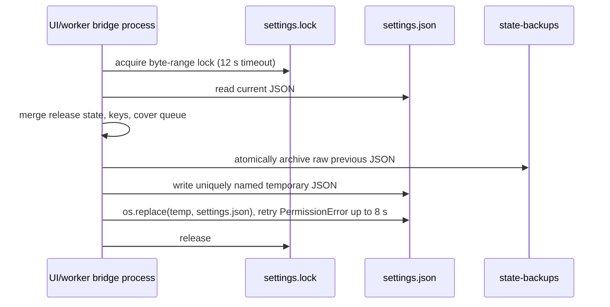

# NEWSFLOW DATA PERSISTENCE MAP

**Audit mode:** source only; no user settings, tokens, media, SQLite rows or browser profile contents were opened.

## Canonical roots

| Location | Owner | Contents / behavior |
|---|---|---|
| `%LOCALAPPDATA%/NewsFlow` | `scriptor.config.app_data_root()` | Canonical application state root. Created when the function is called. |
| `%LOCALAPPDATA%/NewsFlow/settings.json` | `config_path()` / `save_settings()` | Primary durable settings, queues, channel metadata, protected credential payloads and UI configuration. |
| `%LOCALAPPDATA%/NewsFlow/state-backups/settings-last-known-good.json` | `_archive_pre_write_settings()` | One raw pre-write rollback copy, atomically replaced before each normal settings write. |
| `%LOCALAPPDATA%/NewsFlow/covers-library.json` | `scriptor.cover_library` / bridge | Release-independent cover registry, tombstones, FastGen capability/usage cache and face configuration. |
| `%LOCALAPPDATA%/NewsFlow/footage-index.sqlite3` | `scriptor.footage.ClipIndex` | Footage index database. |
| `%LOCALAPPDATA%/NewsFlow/footage-index-status.json` | bridge + Electron | Small progress/status projection for the footage UI. |
| `%LOCALAPPDATA%/NewsFlow/ChromeSessions/<profile_id>` | `sessions_root()` | One persistent Chrome profile directory per configured session/channel. Cookies are not surfaced in snapshot. |
| `%LOCALAPPDATA%/NewsFlow/*.lock` | settings, cover, footage/montage workers | Interprocess coordination / recovery markers. |
| Configurable media roots | `storyflow_documents_root()` and settings | Default `D:/NewsFlow Studio` when D: exists; fallback Documents root. Individual user overrides are retained. |

## Settings state classification

| Domain | Representative fields in `Settings` | Durability / safety note |
|---|---|---|
| Credentials | FastGen, OpenAI, TTS key pools; YouTube OAuth tokens/API key; Obsidian token | Serialized as DPAPI-protected fields through `security.protect`; plaintext enters runtime only after local unprotect. |
| OAuth and channels | `analytics_channels`, `youtube_oauth_tokens`, pending handoffs, `chrome_sessions` | Separate channel metadata and Chrome-profile identity. Tokens should not be copied to UI snapshot. |
| Ideas and scripts | topics, plans, results, source/context metadata, production items | Preserved as release state during concurrent saves unless an explicit destructive command authorizes empty state. |
| Voice | profiles, ranges, queues, jobs, output mapping, status/import summary | Audio files themselves live in configured media folders. |
| Covers | prompts/presets, text, references, faces, queue, limits, selected keys, output folder | Queue is additionally merged with `covers-library.json`; tombstones prevent resurrection. |
| Footage and montage | folder paths, index config, montage statuses, clip reuse, `.newsflow` project paths | Index is SQLite; planning/render outputs are external files under configured roots. |
| Publication | legacy jobs and V2 items/snapshots/executions/receipts/allocation/rules | V2 migration projects legacy data non-destructively; artifact existence is periodically reconciled. |
| UI/preferences | target, stages, templates, provider/model settings, visibility/format choices | Stored in `settings.json`. |
| Research | `channel_research` keyed by profile ID | Stores public task/result state; test asserts token/cookie data absent from export. |

## Settings write and recovery mechanics

`save_settings()` applies merge safeguards for release state, API-key records, montage status and cover queue. This materially reduces a stale detached worker overwriting newly saved state. It is not a transactional database: a process that continuously fails to obtain the lock returns an error.

## Migration behavior

* `migrate_newsflow_storage()` changes old default media paths to the current default and explicitly documents that it **does not move or delete files**. Custom user paths remain unchanged.
* Paths under Windows Temp or prior `newsflow-snapshot-*` roots are redirected to a durable default to avoid persisting disposable locations.
* `load_settings()` can supplement absent credentials/channel records from an old `%LOCALAPPDATA%/Scriptor/settings.json` or NewsFlow backup candidates. DPAPI keeps encrypted values scoped to the Windows user.
* `publication_v2.migrate_legacy_publication_data()` creates V2 projections without deleting legacy jobs; missing files are reported as missing, not claimed to have been moved.
* Cover-library hydration preserves records when a release begins with an empty settings queue; explicit tombstones win.

## Data-loss and privacy observations

1. `load_settings()` falls back to an empty `data` object on any JSON read/parse exception. A later successful save could persist defaults over unreadable state. The pre-write backup helps only when a prior readable file exists. **Risk: high; see ISS-01.**
2. `snapshot()` has write side effects and is unsuitable as an audit-safe inspection endpoint. **Risk: medium.**
3. `delete_session_profile()` recursively deletes a profile after containment validation. It is not called by the inspected UI removal path, which explicitly says session is retained; actual destructive command reachability is **NOT VERIFIED**.
4. Sensitive values are deliberately omitted from this document. The audit did not inspect raw JSON or DPAPI-protected blobs.

## Backup-before-upgrade checklist

1. Copy `%LOCALAPPDATA%/NewsFlow/settings.json`, `covers-library.json`, state backups and ChromeSessions without editing originals.
2. Back up configured media roots and any `.newsflow`, audio, image, MP4 and package output folders.
3. Start the new version against the same canonical `%LOCALAPPDATA%/NewsFlow` root; do not replace it with a blank portable-relative directory.
4. Verify snapshot-visible counts, channel labels, cover gallery rows, voice/montage/publication queues and paths before any cleanup.

This checklist is source-informed only; it was not executed during the read-only audit.
