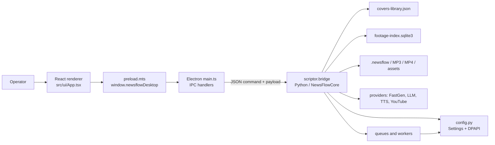
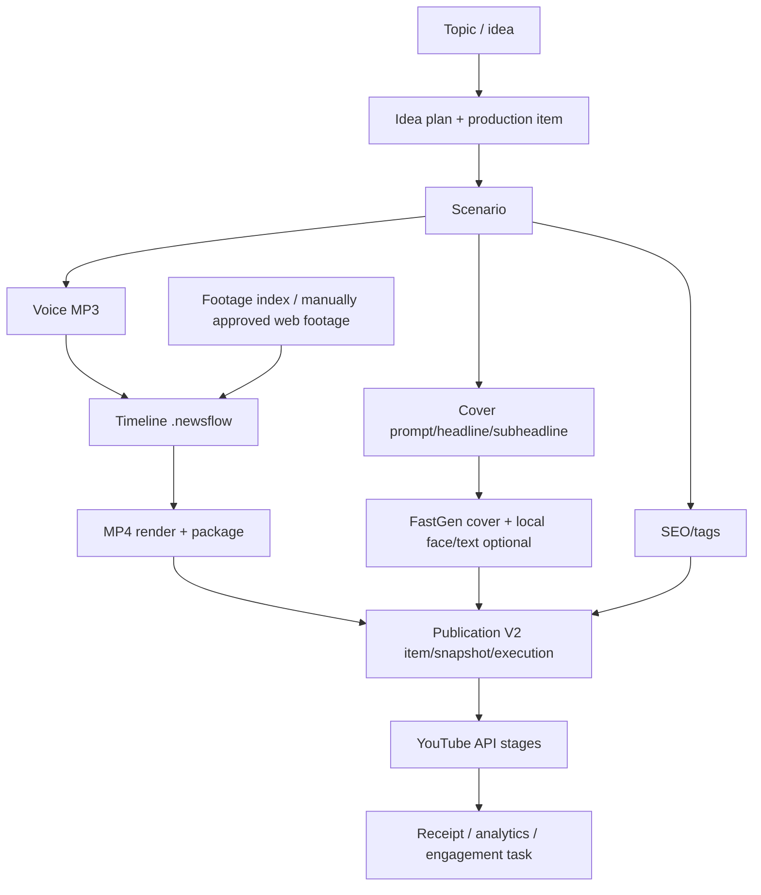

# NEWSFLOW DEEP SYSTEM MAP

**Audit mode:** static source audit, read-only. **Audit date:** 2026-09-11.  No API requests, OAuth flow, queue action, production-data write, build, or EXE launch was performed.

## Scope and evidence standard

This map describes the checked source tree at the audit date, principally `scriptor/`, `studio-ui-remotion-verify/`, `electron/`, `tests/`, and `Scriptor.spec`. A statement marked **NOT VERIFIED** needs a live controlled run. Secrets, tokens, cookie values, user media paths, and settings contents were not read or reproduced.

## Runtime topology

The Electron renderer has no direct Node access (`contextIsolation: true`, `nodeIntegration: false` in `electron/main.ts`). It receives only the preload bridge. `callCore()` serializes a command and payload, starts either Python (`-m scriptor.bridge`) in development or `NewsFlowCore.exe` in a portable build, then parses one JSON response. The special montage command is spawned detached from the request/response execution path and UI reloads a snapshot after 180 ms.

## Process and entry points

| Layer | Entry / evidence | Responsibility |
|---|---|---|
| Desktop | `studio-ui-remotion-verify/electron/main.ts` | Creates window, IPC, Python/Core child processes, hourly FastGen resume check, native file dialogs. |
| Browser boundary | `electron/preload.mts` | Exposes snapshot, command, chooser, open-path and OAuth handoff methods. |
| Backend CLI | `bridge_main.py` → `scriptor.bridge.main()` | Switches 194 command names to domain operations and emits JSON. |
| Persistent settings | `scriptor/config.py` | Loads, migrates, DPAPI-protects secret fields, merges concurrent state and atomically replaces settings. |
| Portable backend | `Scriptor.spec` | PyInstaller package of `scriptor`, assets, Python libraries, providers and `NewsFlowCore`. |
| Renderer | `src/ui/App.tsx` + `src/ui/publication/*` | Single-page React UI, page routing, state snapshot and command dispatch. |

## Source file index

| Path | Audit relevance |
|---|---|
| `bridge_main.py` | Thin packaged/development CLI entry point. |
| `scriptor/bridge.py` | Primary command dispatcher, snapshot, workflow orchestration and provider boundaries. |
| `scriptor/config.py` | Canonical persistence root, full Settings schema, migrations, backups and concurrent write merging. |
| `scriptor/security.py` | Local protected-secret conversion. |
| `scriptor/thumbnail_prompt_v2.py` | Universal V2 final cover-prompt assembly. |
| `scriptor/cover_library.py`, `scriptor/covers.py`, `scriptor/cover_rate_limit.py` | Cover registry, image state and rate limit logic. |
| `scriptor/footage.py` | SQLite index and footage analysis model. |
| `scriptor/timeline.py` | Editable `.newsflow` timeline representation. |
| `scriptor/publication_v2.py` | Non-destructive legacy-to-V2 publication projection and allocation. |
| `scriptor/youtube_*.py` | OAuth, API, publisher, Studio and engagement adapters. |
| `scriptor/channel_research.py` | Per-profile research record model and export helpers. |
| `studio-ui-remotion-verify/electron/main.ts` | Electron process model, IPC, packaged-core launch and special montage/OAuth handling. |
| `studio-ui-remotion-verify/electron/preload.mts` | Renderer capability boundary. |
| `studio-ui-remotion-verify/src/ui/App.tsx` | Main page shell and most interactive controls. |
| `studio-ui-remotion-verify/src/ui/publication/*` | Modernized publication UI components. |
| `studio-ui-remotion-verify/src/ui/components/*` | Reusable UI primitives. |
| `Scriptor.spec` | PyInstaller backend composition. |
| `tests/test_*.py`, `src/ui/**/*.test.tsx` | Intended unit/integration coverage; not executed here. |

## Screen inventory (source-derived)

`Page` in `src/ui/App.tsx` declares 25 pages. The sidebar groups route to the following functional surfaces:

| Surface | Component(s) | Primary domain |
|---|---|---|
| Control center | `Dashboard` | pipeline target, enabled stages, automatic run |
| Ideas | `Ideas` | topics, reference channels, research, generation, plan |
| Scenarios / scripts | `Scenarios`, `FinishedScripts` | script generation, editing, import/export, transfer |
| Templates / agents | `TemplateEditor`, `Agents` | prompt templates and provider routes |
| Covers | `Covers`, `CoverGallery` | prompts, headlines, faces, FastGen queue, local text, gallery |
| Media / SEO / tags | `Media`, `Seo`, `Tags`, `SeoPrefixRanges` | media generation and metadata packages |
| Footage / cutter | `Footage`, `Cutter` | source folders, local index, web research/download, cut/mix |
| Montage | `MontageLiveStatus`, `Editor`, `Outputs` | timeline plan, render queue, exports and packages |
| Publication | `PublicationPage` and subcomponents | V2 allocation, execution, YouTube upload and receipts |
| Voice | `VoiceQueue`, `Audio`, pools and profiles | TTS ranges, import, API/Chrome profiles |
| Analytics / sessions | `AnalyticsDashboard`, `Sessions` | channel profiles, OAuth, analytics and Chrome sessions |
| Keys / knowledge | `Keys`, `Knowledge` | API credentials and Obsidian integration |

The static JSX inventory contains **665** interactive-element occurrences across 19 `.tsx` UI files (646 are in the monolithic `App.tsx`). This is an occurrence count, not a claim that 665 controls are simultaneously visible.

## End-to-end production flow

`snapshot()` projects this distributed state into a large UI DTO and is read-only. Recovery/migration/normalization requires the explicit `reconcile-runtime-state` path; that boundary prevents a UI refresh from mutating persistent user data.

## Provider and prompt boundary

Cover generation uses a single final provider prompt constructed in `scriptor/thumbnail_prompt_v2.py`. The intended ordered blocks are: core style, story context, subject, people, action, evidence, environment, emotion, composition, identity/references, headline, subheadline, typography, red accents, final negatives. `scriptor/bridge.py` stores the final prompt and passes it to FastGen. Tests in `tests/test_covers.py` cover duplicate blocks and payload equality.

Other configured provider families evidenced in code are Chrome/agent routes, OpenAI, FastGen, Secret Voicer, Lumean, VoiceGen, WProject, YouTube Data/Analytics and an optional Obsidian MCP. Provider credentials are stored locally in protected fields; the audit did not access them.

## Channel research status

`scriptor/channel_research.py` implements a non-secret per-profile model, URL parsing/deduplication, state recovery, result serialization and tests. `bridge.import_channel_research_txt()` imports URLs for a selected analytics channel. There is no source evidence of a dispatched run/pause/stop/search executor or a dedicated renderer page in the current `Page` union. Therefore the previously designed channel-research-agent workflow is **PARTIALLY IMPLEMENTED / NOT VERIFIED**, not complete.

## Trust boundaries

* Renderer may request arbitrary command names through a generic IPC `newsflow:command`; backend allowlisting occurs only in the Python `if/elif` dispatcher.
* Backend operates on user-selected paths and external provider responses.
* OAuth handoff session metadata is kept in Electron memory while the backend persists pending encrypted handoffs; exact cloud callback behavior is **NOT VERIFIED** in this audit.
* Chrome profile directories belong below `%LOCALAPPDATA%/NewsFlow/ChromeSessions`; browser cookies were neither inspected nor exported.

See also: [dependency inventory](NEWSFLOW_DEPENDENCY_INVENTORY.md), [button dependency matrix](NEWSFLOW_BUTTON_DEPENDENCY_MATRIX.md), [persistence map](NEWSFLOW_DATA_PERSISTENCE_MAP.md), [module map](NEWSFLOW_MODULE_DEPENDENCY_MAP.md), [screenshot atlas](NEWSFLOW_SCREENSHOT_UI_ATLAS.md), and [issues](NEWSFLOW_ARCHITECTURE_ISSUES.md).
