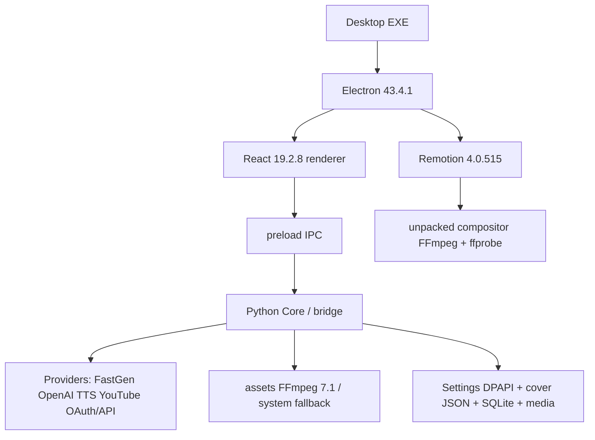

# NEWSFLOW DEPENDENCY INVENTORY

**Audit basis:** `studio-ui-remotion-verify/package.json` and `pnpm-lock.yaml`, root `requirements.txt`, `Scriptor.spec`, Electron/Vite/Remotion build scripts, inspected bundled core and system executables. No dependency was installed, updated or removed.

## Manifests and lock sources

| Manifest | Status | Audit conclusion |
|---|---|---|
| `studio-ui-remotion-verify/package.json` | Present, app 2.1.152 | Authoritative direct Node dependency and packaging declaration. |
| `studio-ui-remotion-verify/pnpm-lock.yaml` | Present, lockfile v9 | Resolves exact Node closure; direct resolutions below are confirmed from importer. |
| Root `requirements.txt` | Present | Python direct requirements are ranges, not a lock. |
| `pyproject.toml`, `poetry.lock`, root `package-lock.json`, root `yarn.lock` | Not found | No Python lock / npm lock source for this application. |
| `oauth-site/worker/pnpm-lock.yaml` | Present, separate worker project | Out of desktop runtime scope; not included as NewsFlow Studio desktop dependency. |
| `Scriptor.spec` | Present | PyInstaller collection specification. |
| `vite.config.ts`, `electron/tsconfig.json`, `remotion/render.mjs`, build/verify scripts | Present | Build/runtime configuration, not package manifests. |
| `playwright.config.*`, `remotion.config.*`, `electron-builder.*` | Not found | Playwright and Remotion are configured through code/scripts/package build block. |

## Exact runtime/tool versions observed

| Item | Declared | Resolved / binary observed | Evidence | Packaging status |
|---|---|---|---|---|
| Node | none | 24.19.0 system | `node --version` | Dev/build host; Electron embeds separate Node runtime. |
| npm | none | 11.17.0 system | `npm --version` | Dev only; project uses pnpm lock. |
| Python | none | 3.12.10 system | `python --version` | Build/dev host; PyInstaller embeds Python runtime in Core. |
| PyInstaller | none | 6.22.2 system | `pyinstaller --version` | Build only; output is bundled Core. |
| Electron | 43.4.1 | 43.4.1 | package lock/node module | Packaged into desktop EXE/app resources. |
| React / React DOM | `latest` | 19.2.8 / 19.2.8 | pnpm importer | Renderer bundle. |
| Vite | `latest` | 8.2.2 | pnpm importer | Build only. |
| TypeScript | `latest` | 7.0.2 | pnpm importer | Build/typecheck only, incorrectly listed under runtime deps. |
| electron-builder | `latest` | 26.15.3 | pnpm importer | Packaging only. |
| Remotion family | 4.0.515 | 4.0.515 | package/lock | Renderer runtime; compositor binaries copied to resources. |
| Playwright | `>=1.54,<2` | 1.62.0 in inspected bundled Core | `requirements.txt`; packaged driver `package.json` | Core includes driver; browser availability is runtime-dependent. |
| system FFmpeg / ffprobe | none | 9.0.1 full build | system command | Host fallback; not guaranteed by package. |
| bundled asset FFmpeg | asset | 7.1 essentials build | `assets/ffmpeg.exe --version` | Included by PyInstaller assets; no sibling `assets/ffprobe.exe` found. |
| Remotion FFmpeg / ffprobe | transitive compositor 4.0.515 | native pair expected | builder/portable verification scripts | Copied to `resources/remotion-binaries`. |

## Node direct dependencies

`D` = direct. `P` = packaged with desktop when needed by Electron/renderer. “Source” lists observed use; `UNMAPPED` means no direct import found in the inspected source and removal must not be inferred safe.

| Name / exact resolved | Ecosystem | D / transitive | Used by / source | Purpose | Runtime / build / dev | P | Optional / legacy | Risk if removed / updated |
|---|---|---|---|---|---|---|---|---|
| `electron` 43.4.1 | Node | D | `electron/main.ts`, `preload.mts` | desktop host and IPC | runtime + build | Yes | no | App cannot start; major updates can break IPC/packaging. |
| `react`, `react-dom` 19.2.8 | Node | D | `src/ui/**/*.tsx`, `remotion/src` | UI rendering | runtime | bundled renderer | no | UI fails; `latest` declaration makes future install non-reproducible. |
| `vite` 8.2.2 | Node | D | `vite.config.ts`, scripts | dev server / web build | build | No | no | build fails; `latest` risk. |
| `typescript` 7.0.2 | Node | D | `tsconfig`, `build:web`, `build:desktop` | typecheck/transpile input | build only | No | **misclassified runtime dependency** | build fails; `latest` risk / npm install variance. |
| `@vitejs/plugin-react` 6.1.0 | Node | D dev | `vite.config.ts` | React transform | build | No | no | build fails; Vite/plugin compatibility risk. |
| `@tailwindcss/vite`, `tailwindcss` 4.3.3 | Node | D dev | `vite.config.ts`, CSS | utility CSS build integration | build | No | likely active | styles/build may change. |
| `tailwind-merge` 3.6.0 | Node | D | `src/ui/components/cn.ts` | class merging | runtime | renderer bundle | no | class composition breaks. |
| `class-variance-authority` 0.7.1 | Node | D | `components/button.tsx` | button variants | runtime | renderer bundle | no | primitive UI fails. |
| `clsx` 2.1.1 | Node | D | `components/cn.ts` | conditional classes | runtime | renderer bundle | no | UI class composition fails. |
| `lucide-react` 1.33.0 | Node | D | `App.tsx`, publication UI | icons | runtime | renderer bundle | no | UI build fails. |
| `@radix-ui/react-dialog` 1.1.23 | Node | D | sheet/dialog primitive | accessible dialog foundation | runtime | renderer bundle | no | sheets/modals fail. |
| `@radix-ui/react-tooltip` 1.2.16 | Node | D | tooltip primitive | tooltips | runtime | renderer bundle | no | tooltip UI fails. |
| `@tanstack/react-table` 8.21.3 | Node | D | `components/data-table.tsx`, publication tables | table model | runtime | renderer bundle | no | publication tables fail. |
| `@remotion/bundler`, `@remotion/cli`, `@remotion/media`, `@remotion/renderer`, `remotion` 4.0.515 | Node | D | `scripts/build-remotion.mjs`, `remotion/*` | prebuild and encode montage compositions | build + runtime | renderer/binaries | CLI is build-only; all pinned consistently | montage build/render fails; family must upgrade together. |
| `@remotion/compositor-win32-x64-msvc` 4.0.515 | Node | transitive | package `extraResources`, `render.mjs` | native encoder plus FFmpeg/ffprobe | runtime | Yes, unpacked | Windows x64 only | MP4 render fails; OS/ABI/version coupling. |
| `vitest` 5.0.0, `jsdom` 30.0.1, Testing Library 7.0.1/16.3.3 | Node | D dev | `*.test.tsx`, `test:ui` | UI tests | dev/test only | No | no | test suite fails; not application runtime. |
| `@types/node` 26.2.0, `@types/react` 19.2.18, `@types/react-dom` 19.2.7 | Node | D dev | TypeScript compilation | type declarations | dev only | No | no | typecheck fails; runtime unaffected. |
| `electron-builder` 26.15.3 | Node | D dev | package scripts/build config | Windows portable/NSIS packaging | build only | No | no | no release package; `latest` risk. |

## Python direct requirements

| Name / declared range | Ecosystem | D / transitive | Used by / source files | Purpose | Runtime / build / dev | Packaged into Core | Optional / legacy | Risk if removed / updated |
|---|---|---|---|---|---|---|---|---|
| `playwright >=1.54,<2` | Python | D | `claude.py`, browser/OAuth/Studio paths | Chrome automation driver | runtime | Yes (`Scriptor.spec collect_all`) | runtime browser use optional by feature | OAuth/Studio paths fail; browser driver/API changes. |
| `tkinterdnd2 >=0.4,<1` | Python | D | legacy Tk app support | drag/drop for Tk UI | runtime | Yes | **legacy relative to Electron UI** | likely legacy desktop path breaks; candidate for isolated proof. |
| `fastembed >=0.8,<1` | Python | D | footage/AI index path | local embeddings | runtime | Yes | feature optional | footage semantic index fails; model/API size/change risk. |
| `imageio-ffmpeg >=0.6,<1` | Python | D | media tooling dependency | FFmpeg discovery/helper | runtime | Yes | potentially duplicate with bundled FFmpeg | media fallback changes; version may alter binary lookup. |
| `opencv-python-headless >=4.12,<6` | Python | D | footage/covers/video analysis | frame/image CV | runtime | Yes | feature dependent | analysis/cut/face paths fail; binary ABI risk. |
| `pillow >=12,<13` | Python | D | `bridge.py`, Tk/cover text/image processing | raster manipulation | runtime | Yes | no | covers/local overlays fail. |
| `numpy >=2,<3` | Python | D | CV/embedding/tests | array operations | runtime | Yes | transitive companion to CV/ML | CV/embedding fails; ABI risk with OpenCV/ONNX. |
| `rembg >=2,<3` | Python | D | face-library preparation path | portrait background removal | runtime | Yes | optional feature | face prep fails; includes model/runtime dependencies. |
| `yt-dlp >=2026.7,<2027` | Python | D | explicit web footage | source retrieval | runtime | Yes | optional / external-site dependent | download feature fails; frequent upstream compatibility risk. |
| `google-auth-oauthlib >=1.2,<2` | Python | D | `youtube_oauth.py` | OAuth desktop flow | runtime | Yes | required only YouTube OAuth | OAuth fails; Google protocol compatibility risk. |
| `google-api-python-client >=2,<3` | Python | D | `youtube_api.py`, publisher | YouTube Data/Analytics API | runtime | Yes | required only YouTube features | upload/analytics fail; API behavior/version risk. |
| `tzdata >=2025.2,<2027` | Python | D | `publication_v2.py` `ZoneInfo` | IANA zones on Windows | runtime | Yes | Windows runtime requirement | scheduled publication timestamps can fail/drift. |

## Transitive / bundled system closure

* The pnpm lock is the complete exact Node transitive source of truth; direct importer resolution already pulls React peer packages, Radix/Floating UI, Vite/esbuild/Rolldown, Electron builder, Remotion compositor/media/parser and test closure. Transitives are **not direct source imports** and inherit the purpose/risk of their direct parent.
* `Scriptor.spec` explicitly collects `tkinterdnd2`, `playwright`, `fastembed`, `onnxruntime`, `cv2`, `PIL`, `numpy`, `google`, `googleapiclient`, `google_auth_oauthlib`, `tzdata` and assets. These are packaged Core constituents; their separately resolved pip versions are **NOT LOCKED / NOT VERIFIED** from an installed build manifest.
* Packaged Core also contains Python standard library, Tcl/Tk support files and Playwright driver. Electron separately ships Chromium/Node. Remotion native encoder is separately unpacked because it cannot run from `app.asar`.

## Unused, duplicate and legacy candidates (no removal made)

| Candidate | Evidence | Classification / risk |
|---|---|---|
| `tkinterdnd2` + Tk modules | `Scriptor.spec` and `scriptor/app.py`; Electron is current UI | Legacy parallel UI path. Do not remove without proving `scriptor.app` is retired. |
| `typescript`, `vite` under `dependencies` | package declares them runtime, but scripts use them only build-time | Dependency-classification duplicate; package bloat/reproducibility risk, not proof they are unused. |
| system FFmpeg 9.0.1, asset FFmpeg 7.1, Remotion FFmpeg/ffprobe | three sources observed | Intentional fallbacks / duplicate version exposure; behavior may differ by invocation path. |
| legacy Core directories (`.core-bin-2.1.149`, `.150`, `.151-v2`) | filesystem inventory | Historical build artifacts, not current `extraResources` target. Do not delete in audit. |
| legacy/modern publication and analytics UI components | source names `Legacy…` alongside V2 | Feature/code duplication, not package dependency. |
| `@remotion/cli` | direct package, no direct source import | Used as a toolchain dependency; may be redundant at runtime, but removal needs package-build proof. |

## Dependency graph

## Audit recommendations

Pin `latest` declarations to tested versions, create a Python lock/SBOM, document the active FFmpeg precedence, and split legacy Tk/core artifacts from release inputs. These are audit recommendations only; no dependency or configuration was changed.
