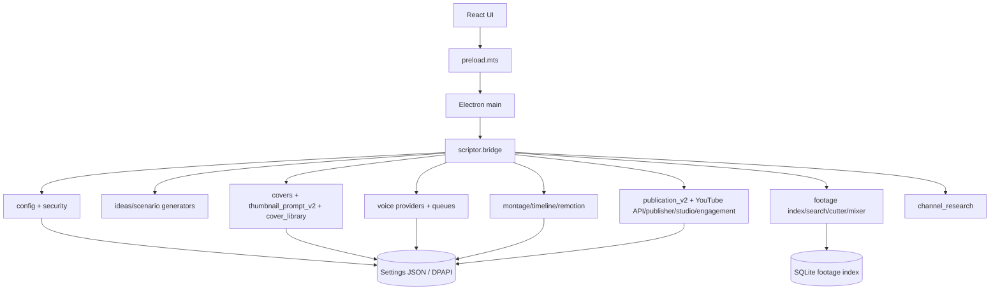

# NEWSFLOW MODULE DEPENDENCY MAP

## Top-level map

## Backend modules and dependencies

| Module/group | Direct role | Important links |
|---|---|---|
| `scriptor/bridge.py` | Application façade and 194-command dispatcher; snapshot projection | Imports/configures almost every domain. Primary coupling hub. |
| `scriptor/config.py` | `Settings`, storage roots, load/save/migrate/merge/protection mapping | Used by virtually all stateful operations. |
| `scriptor/security.py` | DPAPI protect/unprotect abstraction | Credential serialization boundary. |
| `thumbnail_prompt_v2.py` | Structured Universal V2 final provider prompt assembly | Called by cover path; prompt source debug exists. |
| `covers.py`, `cover_library.py`, `cover_rate_limit.py` | Cover result storage, independent library, rate status | Cover queue duplication/merge boundary with Settings. |
| `fastgen.py` (and pool/client code) | Provider capabilities, usage and image request transport | Receives final cover provider prompt. |
| voice provider modules (`voicer`, `lumean`, `voicegen`, `wproject`) | TTS API behavior and rate/failover data | Used by `generate_voice`; output paths set by Settings. |
| `footage.py` | SQLite `ClipIndex`, embeddings/scan metadata | Status side-file supports UI polling. |
| cutter/mixer/web-footage modules | Source processing and explicit web-footage selection/download | Depends on user-selected folder/output settings. |
| `timeline.py`, montage/render modules | `.newsflow` project, clip plans, ffmpeg/Remotion output | Electron passes Remotion Node/runner environment. |
| `publication_v2.py` | V2 migration, readiness, allocation and execution records | In-memory domain operations persisted by bridge. |
| `youtube_api.py`, `youtube_publisher.py`, `youtube_oauth.py`, `youtube_studio.py`, `youtube_engagement.py` | API OAuth/analytics/upload and Studio/engagement support | Authorization and actual external side effects require live verification. |
| `channel_research.py` | Isolated public-source queue record helpers, TXT import/export | Current source has model layer but no complete executor/UI. |

## Frontend modules

| Module | Role | Dependency issue |
|---|---|---|
| `src/ui/App.tsx` | 13k+ line route shell and most screens/actions | Dominates 646/665 interactive occurrences; owns command labels and many domain views. |
| `src/ui/publication/*` | Modern publication header, tables, queue, history, timeline | Better component split, but data originates from global snapshot. |
| `src/ui/thumbnail-word-actions.ts` | Maps cover controls to payload conventions | Couples UI action names to bridge payload schema. |
| `src/ui/components/*` | Button, badge, sheet, tabs, data table, tooltip primitives | Partial shared design-system layer. |
| `src/ui/*.css` | Domain CSS files | Many coexisting styles, plus a giant all-domain App component. |

## Command coverage

Static extraction finds **194** backend command branches and **175** literal UI command names. This is not automatically an error: some backend commands are internal, legacy, not mounted in UI, or accessed through non-literal code. The following source-backed drift candidates should be reconciled by tests or manifest generation:

* Backend-only: `snapshot`, OAuth handoff finish/cancel/start, legacy cover suggestion/import helpers, index/prepare/render montage operations, legacy publication operations and some research import operations.
* UI-only extraction did not include direct methods (`snapshot`, `saveSettings`, native choosers, OAuth handoff) because they do not use `command("…")`.
* Both command tables are manually maintained `if/elif`/string calls rather than generated from a typed shared contract.

## Test landscape observed

Test files exist for covers, cover library/tombstones, montage queue/render, publication V2, YouTube publisher/OAuth/Studio/engagement/allocation, OAuth site/handoff persistence, Electron OAuth launch and channel research. The audit did **not** execute them to avoid a possible write to the active application root. Existing test files are evidence of intended coverage, not proof of current green status.

## Dependency hotspots

1. **Bridge + Settings:** most business actions load and save the full settings document.
2. **App.tsx + snapshot DTO:** one frontend component consumes a broad DTO and owns cross-domain commands.
3. **Snapshot + recovery:** a rendering refresh can mutate production state.
4. **Publication compatibility:** legacy and V2 structures coexist and are projected/migrated repeatedly.
5. **Cover storage:** Settings queue and separate library must be reconciled on hydration/save.
