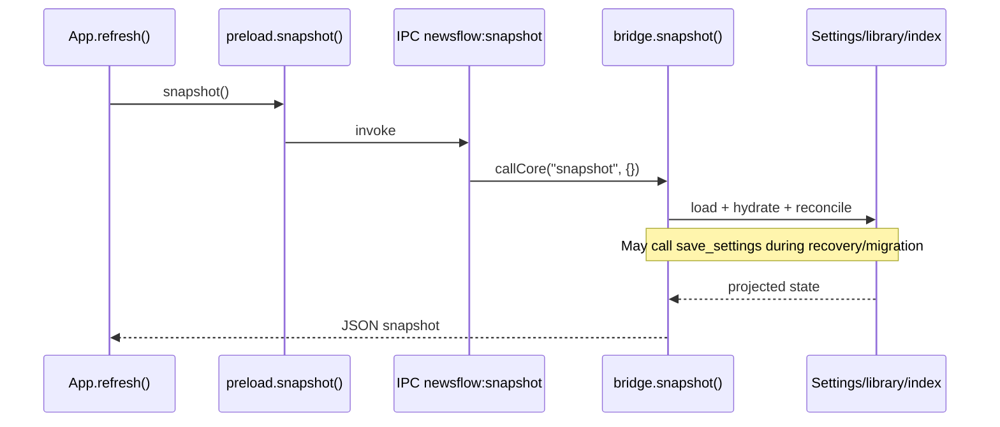
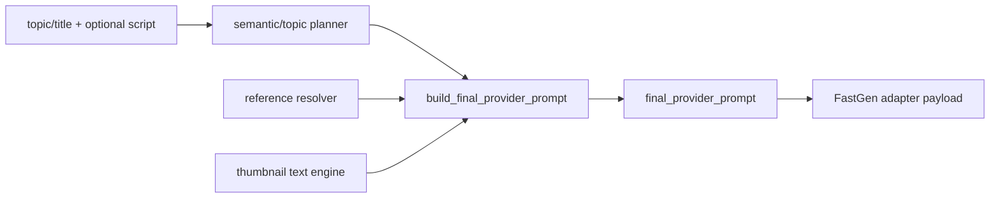
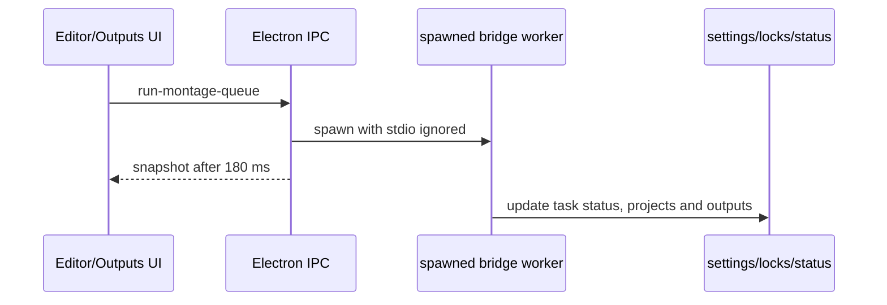
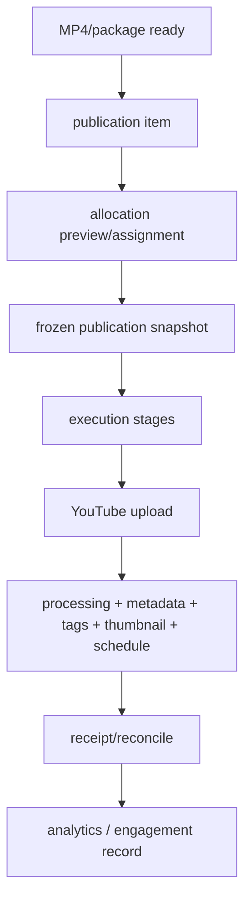
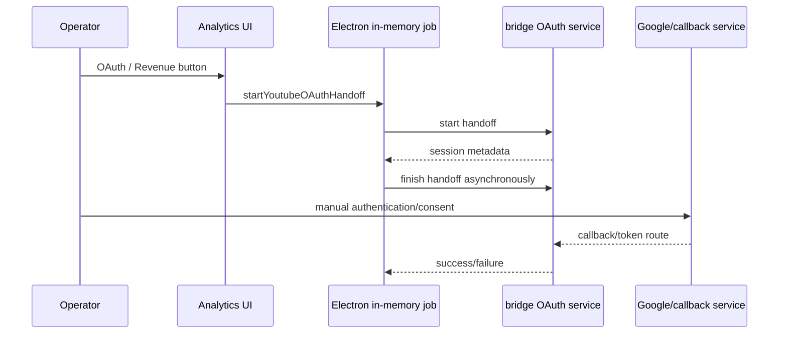

# NEWSFLOW RUNTIME EXECUTION TRACES

**Trace classification:** source-derived execution traces, not live recordings. No production command was invoked. Each trace identifies the code route and its verification gap.

## T-01: Renderer refresh / snapshot



**Source evidence:** `App.tsx` initial `useEffect(refresh)`, preload `snapshot`, `electron/main.ts` IPC, `bridge.snapshot`. **Outcome:** route is statically certain. **NOT VERIFIED:** rendering against a real existing state. **Important:** this trace may write state and was not executed.

## T-02: Cover creation button → FastGen

```mermaid
sequenceDiagram
  participant C as Covers UI
  participant A as App.command
  participant B as bridge.generate_covers
  participant L as cover-generation.lock
  participant P as thumbnail_prompt_v2
  participant F as FastGenPool/API
  participant S as settings + cover library
  C->>A: command("generate-covers", indices/options)
  A->>B: generic IPC JSON
  B->>L: claim process lock
  B->>S: hydrate queue; select missing image rows
  B->>P: construct final provider prompt once
  P-->>B: final prompt + source debug
  B->>F: image request(s), max 10 topic workers
  F-->>B: result/error
  B->>S: persist progress/paths/status
  B->>L: release in finally
```

**Source evidence:** `App.tsx` command labels, dispatcher branch, `generate_covers`, `_run_parallel_cover_workers`, `thumbnail_prompt_v2.build_final_provider_prompt`. **NOT VERIFIED:** provider acceptance, actual image output and rate-limit handling in the current environment. The audit did not use any API key.

## T-03: Final prompt assembly (current V2 path)



The expected debug attribution is Core style = Universal V2; scene = topic planner; people = reference resolver; text = thumbnail engine; negative = Universal V2. Static tests named `test_prompt_has_single_style_block`, `test_prompt_has_single_headline_block`, `test_prompt_has_single_subheadline_block`, `test_prompt_has_no_legacy_tail`, `test_prompt_has_no_duplicate_sections`, and `test_provider_payload_equals_final_prompt` exist in `tests/test_covers.py`. **NOT VERIFIED:** runtime debug record/payload for a real FastGen call.

## T-04: Montage queue



The worker receives Node/Remotion runtime variables from Electron. **Risk:** the 180 ms response is not a completion signal. **NOT VERIFIED:** worker liveness, cancel/recovery and actual Remotion/ffmpeg output.

## T-05: Publication V2



`publication_v2.py` defines stages `AUTH_CHECK`, `VIDEO_UPLOAD`, `YOUTUBE_PROCESSING`, `TITLE`, `DESCRIPTION`, `TAGS`, `THUMBNAIL`, `POST`, `CARDS`, `END_SCREEN`, `SCHEDULE`. A status called `UNVERIFIED` is explicitly used in the UI for an unconfirmed publish time. **NOT VERIFIED:** any live upload, Studio post/card/end-screen automation, scheduled publish, receipts or external API result.

## T-06: OAuth handoff



Manual authentication was intentionally not automated. The audit did not inspect OAuth token state. **NOT VERIFIED:** callback availability, multi-brand channel selection, refresh metrics and token recovery after process restart.

## T-07: Channel research state

`channel_research.py` trace ends at isolated per-profile task/result record creation, TXT parsing/deduplication and export serialization. The bridge exposes `import-channel-research-txt`; no complete static trace for background discovery, analysis, pause/resume/soft-stop or UI result management exists in the current dispatcher/Page union. **Result: NOT IMPLEMENTED OR NOT REACHABLE; requires clarification before external testing.**
