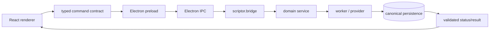

# Runtime topology

Current production transport is generic `window.newsflowDesktop.command(command, payload)` → `newsflow:command` → `scriptor.bridge.main()`. The Light contract phase will make critical command names, request payloads and response/status shapes statically testable without replacing Electron or Python.

The renderer’s initial state uses `snapshot()`. Its current implementation performs recovery and writes; [[05 - Persistence/Settings Persistence]] is the prerequisite for separating safe read projection from explicit reconciliation.
