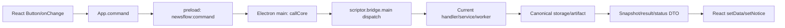

# Button → Runtime Map

## Final Light audit scope — 2026-09-12

This map records the **current** desktop runtime only. It was generated from
the 175 literal `command("…")` calls in `studio-ui-remotion-verify/src`, the
renderer command contract, Electron preload/main handlers, and
`scriptor.bridge.main()` dispatch branches. The audit is static and isolated:
it does not call FastGen, TTS, OAuth, YouTube, a worker, or a production data
folder.

`tests/test_runtime_action_map.py` is the executable source of truth:

- all 175 renderer commands must be in `NEWSFLOW_COMMANDS` and have one
  current `bridge.main()` dispatch branch;
- each direct preload IPC channel must have an Electron handler;
- the current Python bridge must not import `scriptor.app` or
  `scriptor.legacy_bridge`.

The command-family inventory, labels and visible control families are kept in
[[NEWSFLOW_BUTTON_DEPENDENCY_MATRIX]]. It is the exhaustive Button map; this
note adds the runtime boundary and canonical-service rules.

## Common current command path

Every ordinary UI action passes an object payload. `App.command()` first shows
an in-progress notice, updates React data only from the returned snapshot, and
projects rejected IPC calls as an operator-visible error. The backend either
returns a structured snapshot/result or exits with a JSON error; it does not
return a synthetic success.

## Active service map — protected production actions

| User action | Current React command | Bridge handler | Service / worker | Persistent result / visible state |
|---|---|---|---|---|
| Save project/settings | `save-settings` | `save_settings_patch` | `scriptor.config.Settings` atomic writer | current `settings.json`; snapshot + notice/error |
| Create topic | `add-topic` | `add_topic` | current Ideas topic service | `idea_topics`; refreshed ideas state |
| Generate ideas | `generate-ideas` | `generate_ideas` | `scriptor.idea_engine` / selected provider | ProductionItems/idea records; ready/error state |
| Generate scripts | `generate-scenarios` | `generate_scenarios` | scenario worker / selected provider | current session + range/length state |
| Import script | `import-manual-scenario` | `import_manual_scenario` | import service | current session, then snapshot |
| Delete scripts | `remove-scenarios` | `remove_scenarios_command` | `scriptor.session` | tombstoned/current session state |
| Generate cover | `generate-covers` | `generate_covers` | `thumbnail_prompt_v2` → FastGen worker | cover registry/queue and per-row status |
| Generate voice range | `generate-voice-range` | `generate_voice_range` | `tts_ranges` → selected TTS provider | staged/validated MP3, queue status |
| Fast News montage | `run-montage-queue` | `run_montage_queue` | canonical timeline/FFmpeg worker | montage status and duration-validated MP4 |
| Export/package | `package-outputs` | `package_outputs` | output packager | explicit destination + result state |
| Generate SEO/tags | `generate-seo`, `generate-tags` | corresponding handlers | current SEO/tags services | `seo_queue` status and text |
| Upload legacy publication jobs | `upload-publication-jobs` | `upload_publication_jobs` | `youtube_studio` | job state / provider result |
| Create Publication V2 records | `migrate-publication-v2` | `migrate_publication_v2` | `publication_v2` | non-destructive V2 records and result |
| Confirm V2 distribution | `confirm-publication-v2-distribution` | `confirm_publication_v2_distribution` | `publication_v2` | immutable snapshots/execution status |

These actions are registered in `scriptor/command_contract.py`. The bridge
validates object input before the handler and validates a structured output
after it. Each registration forbids the retired `scriptor.app` and
`scriptor.legacy_bridge` modules.

## Direct, non-generic controls

| React/preload action | Electron route | Current behavior |
|---|---|---|
| refresh state | `newsflow:snapshot` → `callCore('snapshot')` | read-model refresh; normal snapshot does not persist migration work |
| generic save target | `newsflow:save-settings` → `callCore('save-settings')` | current atomic settings path |
| OAuth start/status/cancel | `newsflow:youtube-oauth-*` | current Electron-local handoff state plus bridge handoff commands |
| folder/file/save pickers | `newsflow:choose-*` | native dialogs only; no legacy service |
| open local path | `newsflow:open-path` | Electron `shell.openPath` |

The active Analytics screen catches OAuth start and poll failures and puts the
row into the visible `failed` state. This prevents a rejected direct IPC call
from becoming an unhandled promise or an apparent success.

## Current status rule

1. React signals `LOADING` with the action notice.
2. Worker-backed paths persist their own queued/running/progress status before
   work starts.
3. A successful handler returns the current snapshot/result; React then sets
   `SUCCESS` from that returned state.
4. A rejected IPC or bridge error becomes visible `ERROR`; background montage
   spawn failure also rejects the original UI command instead of returning a
   false-success snapshot.

## Fast News Montage — final current path (2026-09-12)

```mermaid
flowchart LR
  A[Montage UI: create queue] --> B[App.command run-montage-queue]
  B --> C[preload newsflow:command]
  C --> D[Electron startMontageQueue]
  D --> E[scriptor.bridge run_montage_queue]
  E --> F[prepare_montage: current index/scene selector]
  F --> G[timeline render_project: FFmpeg]
  G --> H[validate_rendered_montage]
  H --> I[Current settings task status + MP4]
```

`App.tsx` first persists the selected montage settings and then invokes
`run-montage-queue`. Electron deliberately launches this long-lived job via
`startMontageQueue`; a spawn error rejects the original IPC action rather than
returning an optimistic snapshot. The bridge prepares scenes from the finished
script and MP3, uses the current indexed-footage selection path, verifies real
source durations, and gives `render_project` the current settings renderer.

Fast News defaults to the direct cached `ffmpeg` renderer in both
`Settings` and `render_project`, including callers that omit a renderer. An
unmarked old `remotion` setting migrates to `ffmpeg`; Remotion remains only an
operator's explicit composition selection. The FFmpeg service uses the
`proxy-v3-loop-short-source` cache generation, current NVENC `p4` / CPU
`libx264 veryfast` presets, stream-copy concatenation and one final audio mux.
It validates video and audio streams plus duration before a task becomes
`Готово`.

Timeline preparation keeps each normal source at its real duration, appends
real footage to cover a shortage, and may trim only the final source crossing
the narration boundary. The renderer rejects a visual gap instead of making a
frozen tail; the final mux uses `-shortest` only after that coverage check.

Evidence is isolated and reproducible:

- `tests.test_montage_benchmark`: real disposable FFmpeg fixture and default
  route; no production media or settings.
- `tests.test_fast_reuse_render`: complete 30fps MP4 with voice and bounded
  moving-source repeat for a short explicit clip.
- `scriptor.test_montage_render`: last-clip-only trimming, coverage and
  duration/audio validation.
- `tests.test_build_montage_runtime_guard`: mutates a disposable source tree
  to an implicit old `remotion` default and proves the pre-package gate fails.
- `tests.test_core_runtime_guard`: proves a Python core that is newer than the
  bridge but older than `timeline.py` is rejected before packaging.
- `pnpm verify:build-runtime`: binds the current queue/service, FFmpeg default,
  proxy generation and encoder presets before any package command can run.

## Legacy and migration-only list

| Reference | Classification | Rule |
|---|---|---|
| `scriptor.app` Tk desktop | deprecated implementation | never imported by current bridge or current Electron runtime |
| `scriptor.legacy_bridge` | deprecated path | forbidden by command-contract and source-map tests |
| `legacy_session_path()` | migration-only | read only by explicit `migrate_legacy_session()`; normal `load_session()` uses current and current backup only |
| old settings/Scriptor folders | recovery input | not auto-loaded by `load_settings()`; explicit recovery only |
| legacy cover prompt/text fields | explicit `reconcile-runtime-state` recovery | ordinary snapshot and normal render preserve current selection; V2 builder remains provider source |
| legacy publication jobs | non-destructive source records | retained; V2 projection/migration never overwrites the old row |
| nested `core-bin/NewsFlowCore/NewsFlowCore.exe` | prohibited packaged runtime | package accepts only `core-bin/NewsFlowCore.exe`; missing current core fails clearly |
| `release-2.1.127-production/win-unpacked` | archived historical build output | retained as evidence only; current Electron resolution and package scripts never select it |
| `LegacyAnalyticsDashboard` / legacy publication components | inactive source retained for evidence | not rendered from current `App`; no current route invokes them |
| `scriptor.app` Tk montage action | inactive legacy desktop UI | not imported by bridge, not selected by the Electron package entry point, and its omitted renderer can no longer default to Remotion |
| unmarked historical `montage_renderer: remotion` | migration input | `load_settings()` changes it to the current FFmpeg default; a marked user selection remains explicit |

## Regression gates

- `tests.test_runtime_action_map`: all renderer/preload paths are mapped to
  current transport/bridge, and bridge excludes retired imports.
- `scriptor.test_command_contract`: protected action registrations name a
  callable current handler and reject non-object input before work begins.
- `tests.test_ui_delivery`: packaged core cannot fall back to a previous
  layout; montage spawn errors and direct OAuth start/poll errors reach a
  visible error path.
- `tests.test_fast_reuse_render`: a short moving source loops as a bounded
  motion proxy, and the proxy cache generation prevents an old truncated file
  from masking that behavior.
- `tests.test_montage_benchmark`: a direct caller cannot fall back to the old
  implicit Remotion default; the disposable real FFmpeg baseline is bounded.
- `tests.test_build_montage_runtime_guard`: the executable pre-package guard
  rejects a fixture whose Montage default has regressed to old Remotion.
- `tests.test_core_runtime_guard`: a core binary must also be newer than the
  current timeline service, not just the bridge entry point.
- `tests/run_isolated.py`: all Python tests use a disposable data root and
  reject a production storage path.
- `pnpm verify:build-runtime`: pre-package marker/dependency/schema/runtime
  gate. Packaging remains intentionally unrun during this audit.

See also [[ACTIVE_RUNTIME_PATHS]], [[Settings Persistence]], [[Publication]],
and [[16 - Regression Tests/Regression Gates]].
